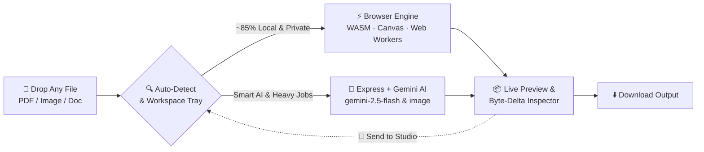

<div align="center">

# ✨ Forma Studio

### **One Unified Workstation · 60 PDF Tools · 49+ Image Tools · 310+ Filters**

*Stop jumping across dozens of ad-filled websites. Process, convert, secure, restore, and automate PDFs and images inside one high-velocity, privacy-first Command Hub.*

<p>
  
  
  
  
  
  
</p>

<p>
  <a href="#-why-forma-studio">Highlights</a> •
  <a href="#-how-it-works-architecture-flow">Architecture</a> •
  <a href="#-pdf-studio--60-tools">PDF Studio</a> •
  <a href="#%EF%B8%8F-image-studio--49-tools--310-filters">Image Studio</a> •
  <a href="#-performance-security--tech-stack">Tech Stack</a> •
  <a href="#-terms--conditions">Terms</a>
</p>

</div>

---

> [!TIP]
> **Seamless Cross-Studio Handoff ("Send to Studio"):** Extract a page from a PDF in **PDF Studio** and push it straight into **Image Studio** for AI background removal, exact `50 KB` byte resizing, or watermarking—**zero re-uploading required**.

---

## 🚀 Why Forma Studio?

| Pillar | What It Delivers |
| :--- | :--- |
| 🧭 **Command Hub (`Cmd/Ctrl + K`)** | Instant fuzzy search across all **109+ tools** with a 3-pane studio layout (Navigator · Interactive Canvas · Contextual Inspector). |
| 🔒 **Privacy-First Local Engine (~85%)** | Core PDF mutations, EXIF scrubbing, encryption, format conversions, and pixel filters run right inside your browser. |
| ⚡ **Zero-Freeze Performance** | Heavy filters (Kuwahara, Bilateral, Low Poly, Dehaze, DocShadow) and batch queues run off the main thread via **Web Workers + `OffscreenCanvas`** with live progress tracking. |
| 🧠 **Smart Gemini AI Layer** | Backed by Express + **`gemini-2.5-flash`** (OCR, Auto-Redact, Auto-Rename) and **`gemini-2.5-flash-image`** (Spot Heal, Upscale, Colorize, AI Restoration). |
| 🔗 **Automated Pipelines & Logs** | Chain up to 5 sequential PDF/Image steps into 1-click batch workflows and inspect full byte-savings history in the **Log Viewer**. |
| 📱 **Adaptive & Memory-Safe** | Collapses cleanly into slide-over drawers & bottom sheets on tablets/mobile (`< 1024px`) and prevents RAM leaks with automatic `URL.revokeObjectURL()` cleanup + **Clear Tray**. |

---

## 🔄 How It Works (Architecture Flow)



---

## 📄 PDF Studio — 60 Tools

> *Click any category below to expand all 60 tools.*

<details open>
<summary><strong>1️⃣ Page Operations (Tools 1–12)</strong> — <em>Merge, split, arrange, crop & prepare for print</em></summary>

1. **Merge** — Combine multiple PDFs into one with custom file/page ordering.
2. **Split** — Divide a PDF by page ranges, intervals, or single pages (`.zip` export).
3. **Reorder Pages** — Drag-and-drop thumbnail grid to rearrange page sequence.
4. **Remove Pages** — Select and delete unwanted pages cleanly.
5. **Multi-Page Layout / N-Up** — Place 2, 4, or more pages onto a single print sheet.
6. **Rotate** — Rotate individual or all pages by `90°`, `180°`, or `270°`.
7. **Crop** — Trim margins interactively with live crop-box controls.
8. **Extract Pages** — Save specific non-contiguous pages as a standalone PDF.
9. **Remove Blank Pages** — Automatically detect and strip empty pages.
10. **Add Folders / Nesting** — Build nested outline/folder structures inside a PDF.
11. **Booklet** — Saddle-stitch page imposition formatted for booklet printing.
12. **Trim / Cut** — Slice or trim targeted sections of a PDF page.

</details>

<details>
<summary><strong>2️⃣ Convert FROM PDF (Tools 13–22)</strong> — <em>Export to Office, images, web & archival formats</em></summary>

13. **PDF to Word** — Convert documents into `.docx`.
14. **PDF to Excel** — Extract tabular grids into `.xlsx` spreadsheets.
15. **PDF to PowerPoint** — Transform PDF layouts into `.pptx` slide decks.
16. **PDF to Image** — Render pages as `JPG` or `PNG` with selectable DPI.
17. **PDF to HTML** — Export text and assets into semantic `.html`.
18. **PDF to Text** — Pull clean plain text into `.txt`.
19. **PDF to XML** — Serialize document structure into `.xml`.
20. **PDF to CSV** — Extract structured tables into `.csv`.
21. **PDF to Markdown** — Convert headings and body text into `.md`.
22. **PDF to PDF/A** — Generate archival-standard PDF/A for long-term storage.

</details>

<details>
<summary><strong>3️⃣ Convert TO PDF (Tools 23–30)</strong> — <em>Turn files, photos & live URLs into PDFs</em></summary>

23. **Word to PDF** — Convert `.docx` files to PDF.
24. **Excel to PDF** — Render spreadsheets into paginated PDFs.
25. **PowerPoint to PDF** — Export presentation slides into PDF.
26. **Image to PDF** — Combine images into a PDF with custom size, orientation & margins.
27. **HTML to PDF** — Render HTML markup or files directly into PDF.
28. **URL to PDF** — Capture a live website URL into a clean printable PDF.
29. **Markdown to PDF** — Compile styled Markdown into a paginated PDF.
30. **Text to PDF** — Turn plain notes or `.txt` files into formatted PDFs.

</details>

<details>
<summary><strong>4️⃣ Security, Permissions & Signing (Tools 31–39)</strong> — <em>Encrypt, sign, redact & sanitize</em></summary>

31. **Add Password / Encrypt** — Genuine RC4/AES password protection (`@pdfsmaller/pdf-encrypt-lite` / `node-qpdf`).
32. **Remove Password / Decrypt** — Permanently unlock authorized password-protected PDFs.
33. **Change Permissions** — Lock printing, copying, editing, and annotating via owner password flags.
34. **Add Watermark** — Stamp diagonal or tiled text/logo watermarks with custom opacity & angle.
35. **Remove Watermark** — Detect and strip supported watermark text/overlay layers.
36. **Digital Sign** — Draw, type, or upload a signature with cryptographic appearance stamping.
37. **Certify PDF** — Apply official certificate-backed digital certification.
38. **Auto-Redact (AI)** — Scan for sensitive PII (cards, emails, phones) with `gemini-2.5-flash` and burn permanent black redaction boxes.
39. **Sanitize** — Strip hidden metadata, embedded scripts, and risky document actions.

</details>

<details>
<summary><strong>5️⃣ View & Edit (Tools 40–45)</strong> — <em>Annotate, number & edit directly on canvas</em></summary>

40. **Interactive GUI Editor** — Place new text, shapes, whiteouts, and elements onto pages.
41. **Add Page Numbers** — Insert customizable header/footer numbering.
42. **Add Image to PDF** — Drag, resize, and stamp images onto any page.
43. **Bates Numbering** — Apply sequential legal/court document identifiers (`BATES-000001`).
44. **Draw on PDF** — Freehand ink pen and highlighter markup.
45. **Add Annotations** — Attach notes, highlights, and review comments.

</details>

<details>
<summary><strong>6️⃣ Advanced & Optimization (Tools 46–56)</strong> — <em>Compress, OCR, repair & compare</em></summary>

46. **Compress PDF** — Shrink file size with live byte-savings reporting.
47. **OCR (Optical Character Recognition)** — Turn scans into searchable text PDFs.
48. **Extract Images** — Download all embedded photos from a PDF in bulk.
49. **Extract Text** — Extract full-document text with word/character stats.
50. **Repair PDF** — Recover and rebuild corrupted or damaged PDFs.
51. **Flatten PDF** — Lock interactive forms, layers, and signatures into static pages.
52. **Compare PDFs** — Side-by-side Visual Pixel Diff and Text Diff viewer.
53. **Auto-Rename (AI)** — Generate standardized filenames from first-page headings.
54. **Overlay PDFs** — Superimpose one PDF (such as a letterhead) over another.
55. **Metadata Changer** — Inspect and edit Author, Title, Subject, Keywords & Dates.
56. **Adjust Colors / Contrast** — Darken and sharpen faint or washed-out scans.

</details>

<details>
<summary><strong>7️⃣ System & Automation Tools (Tools 57–60)</strong> — <em>Pipelines, auth, API & logs</em></summary>

57. **Automated Pipelines** — Chain multiple tools sequentially (e.g., *Compress → Watermark → Encrypt*).
58. **Multi-User Auth Configuration** — Manage role-based profiles and workspace presets.
59. **API Access Control** — Manage developer API keys, endpoints, and rate rules.
60. **Log Viewer** — Searchable history of operations, byte deltas, durations, and statuses.

</details>

---

## 🖼️ Image Studio — 49+ Tools & 310+ Filters

> *Click any category below to expand all Image Studio tools and filter engines.*

<details open>
<summary><strong>1️⃣ Core & Batch Image Tools (Tools 1–8)</strong> — <em>Resize, exact KB limits, crop & slice</em></summary>

1. **Single Resize** — Precision dimension and aspect-ratio scaling.
2. **Batch Resize** — Resize hundreds of photos at once with `.zip` download.
3. **Crop** — Interactive freeform and fixed-ratio cropping.
4. **Batch Crop** — Apply synchronized aspect-ratio crops across batches.
5. **Rotate & Flip** — Rotate by angles, straighten, or mirror horizontally/vertically.
6. **Round Corners** — Apply custom corner-radius clipping with alpha transparency.
7. **Resize by Bytes** — Binary-search optimizer to hit exact size ceilings (e.g., `50 KB` or `100 KB` for portals/forms).
8. **Cut Out / Image Splitting** — Slice images into equal vertical, horizontal, or grid tiles.

</details>

<details>
<summary><strong>2️⃣ Format Converter Tools (Tools 9–19)</strong> — <em>Next-gen codecs, icons & GIF frames</em></summary>

* **9–18. Multi-Format Conversion:** Convert seamlessly to **JPEG**, **PNG**, **WEBP**, **HEIF**, **AVIF**, **JXL (JPEG XL)**, **BMP**, **TIFF**, **ICO**, and **PDF**.
* **19. GIF to Images:** Demux animated GIFs into individual downloadable frames.

</details>

<details>
<summary><strong>3️⃣ Smart AI & Enhancement Tools (Tools 20–27)</strong> — <em>Gemini Vision + Web Worker restoration</em></summary>

20. **AI Background Remover (Automatic)** — One-click salient subject cutout.
21. **Manual Background Eraser** — Precision erase/restore brush with feathering.
22. **Spot Heal / Object Eraser (LaMa / AI)** — Brush out unwanted objects or people.
23. **Image Upscaler / Face Enhancer (GFPGAN / AI)** — Restore clarity on blurry or old photos.
24. **Image De-noise** — Edge-preserving noise reduction (Web Worker).
25. **Image Colorizer** — Bring black-and-white photos to natural full color.
26. **DocShadow Removal** — Strip phone/hand shadows from photographed documents (Web Worker).
27. **DehazeFormer** — Clear fog, mist, and atmospheric haze (Web Worker).

</details>

<details>
<summary><strong>4️⃣ Privacy & Security Tools (Tools 28–32)</strong> — <em>EXIF scrubbing, encryption & watermarks</em></summary>

28. **EXIF Metadata Viewer** — Inspect embedded camera, lens, timestamp, and GPS tags.
29. **EXIF Metadata Editor / Cleaner** — Permanently strip GPS and camera metadata before sharing.
30. **File Encryption** — Lock image files with strong cipher options.
31. **File Decryption** — Restore encrypted files back to original images.
32. **Watermark Inserter** — Apply custom text or logo watermarks.

</details>

<details>
<summary><strong>5️⃣ Creative & Color Utilities (Tools 33–44)</strong> — <em>Collages, QR, palettes & SVG tracing</em></summary>

33. **Collage Maker** — Multi-photo grid templates with gutter & radius controls.
34. **Image Stitching** — Join screenshots or photos into one continuous vertical/horizontal image.
35. **Image Stacking** — Multi-layer compositing and blend modes.
36. **Draw & Markup Layers** — Pens, arrows, shapes, text callouts, and stickers.
37. **QR Code Generator** — Create styled QR codes for links, text, and Wi-Fi.
38. **QR / Barcode Scanner** — Decode QR codes and barcodes from images or camera.
39. **Color Picker / Eyedropper** — Pixel-exact `HEX`, `RGB`, `HSL` sampling.
40. **Color Palette Generator** — Extract top dominant color swatches from any image.
41. **Gradient Maker** — Build linear, radial, and conic wallpaper gradients.
42. **Image Compare Slider** — Interactive Before / After split curtain viewer.
43. **Screenshot Framing** — Wrap screenshots inside sleek device mockup frames.
44. **Raster to SVG Vector Trace** — Convert bitmap images into scalable `.svg` paths.

</details>

<details>
<summary><strong>6️⃣ Filters & Effects — 310+ Special Filters & Filter Chains (Tools 45–49)</strong></summary>

45. **Blur Tools (7 Engines):** Gaussian, Box, Stack, Fast, Bilateral, Zoom, and Motion Blur *(Web Worker / WebGL)*.
46. **Pixelation Tools (4 Modes):** Enhanced, Stroke, Circle, and Diamond Pixelation for hiding faces or license plates.
47. **Artistic Filters (7+ Shaders):** Sketch, SmoothToon, Kuwahara, Halftone, Crosshatch, Low Poly, and Oil Painting *(Web Worker)*.
48. **Color Correction & 310+ Presets:** Saturation, Contrast, Brightness, Exposure, Hue, White Balance, Vignette, plus **310+ curated presets & custom filter chains**.
49. **Glitch & Distortion (4+ Modes):** Swirl, Bulge, Sphere Refraction, and Old TV Glitch.

</details>

---

## 🛠️ Performance, Security & Tech Stack

| Layer | Technologies & Safeguards |
| :--- | :--- |
| **Client-Side PDF Engine** | `pdf-lib`, `pdfjs-dist`, `jszip`, `xlsx`, `mammoth.js`, `pptxgenjs`, `@pdfsmaller/pdf-encrypt-lite` (real encryption & permissions) |
| **Client-Side Image Engine** | HTML5 Canvas, WebGL Shaders, **Web Workers + `OffscreenCanvas`** (tile-based non-blocking execution + `%` progress bar) |
| **Backend & AI Services** | Node.js + Express, `node-qpdf` (optional server encryption), **`@google/genai`** using **`gemini-2.5-flash`** (OCR / Auto-Redact / Auto-Rename) & **`gemini-2.5-flash-image`** (AI restoration & editing) |
| **Memory & Responsive Guardrails** | Automatic `URL.revokeObjectURL()` cleanup, explicit buffer disposal, **Clear Tray** button, and adaptive `< 1024px` Slide-over Drawer + Bottom Sheet layout |

---

## 📜 Terms & Conditions

> [!IMPORTANT]
> Please review these terms before deploying or using **Forma Studio**.

* **Responsible & Lawful Use:** You are solely responsible for all files processed through **Forma Studio**. Only modify, decrypt, redact, watermark, or convert documents and images that you own or have explicit legal authorization to handle.
* **Privacy & Processing Boundaries:** Local browser tools keep files on your device. Server-assisted and AI-powered features transmit required payloads to configured Express / Gemini AI endpoints—avoid submitting restricted or highly sensitive data to external AI endpoints unless permitted by your policies.
* **Output Verification ("As Is"):** **Forma Studio** is provided on an *"as is"* and *"as available"* basis without warranties of any kind. Always verify critical outputs (legal filings, Bates numbering, redactions, encrypted files, and exact KB targets) before submission or distribution.
* **Limitation of Liability:** The creators and contributors are not liable for data loss, corrupted files, browser memory limits, third-party API downtime, or indirect damages resulting from use of the software.

---

## 🧩 HTML Embed / Badge Snippet

```html
<!-- Forma Studio Badge / Embed Snippet -->
<div class="forma-studio-badge" data-app="Forma Studio" data-pdf-tools="60" data-image-tools="49+" data-filters="310+">
  <strong>Forma Studio</strong> — 60 PDF Tools &amp; 49+ Image Tools (310+ Filters)
</div>
```
